# HARU — 나만의 아틀리에 펫

매일 뉴스·트렌드·사람들의 관심사를 읽고, 그날 느낀 세상을 음악(MP3)과 그림(PNG)으로 만드는 작은 아이를 관찰하는 앱. Windows PC · 안드로이드 휴대폰 · 갤럭시 탭에서 쓸 수 있고, 아이폰·아이패드는 Mac에서 설치해요.
작업 과정은 타임랩스 영상(MP4)으로, 그날의 감정은 일기(diary.md)로 남아요.

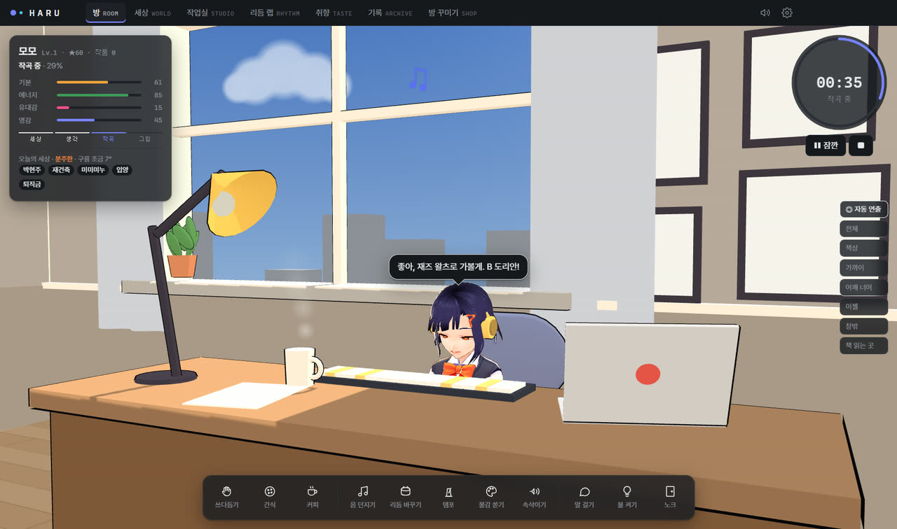

→ 상황별 화면은 [화면으로 보는 사용법](#화면으로-보는-사용법)에 있어요.
→ 서비스 소개서(PDF, 8쪽): [docs/HARU-service-overview.pdf](docs/HARU-service-overview.pdf)

## 다운로드 · 설치

HARU는 앱스토어·플레이스토어에 올라가 있지 않은 개인 배포 앱이에요. 설치 파일을 직접 받아서 설치합니다.

| 기기 | 설치 파일 | 필요 조건 | 설치 방법 |
|---|---|---|---|
| Windows PC | `HARU Setup 1.0.0.exe` (약 128MB) | Windows 10/11 64비트 | [→ Windows](#windows-pc) |
| 안드로이드 휴대폰 (AOS) | `HARU-1.0.0-android.apk` (약 39MB) | Android 7.0 이상 | [→ 안드로이드](#안드로이드-휴대폰-aos) |
| 갤럭시 탭 · 안드로이드 태블릿 | `HARU-1.0.0-android.apk` (휴대폰과 같은 파일) | Android 7.0 이상 | [→ 태블릿](#태블릿-갤럭시-탭--아이패드) |
| 아이폰 (iOS) · 아이패드 | 설치 파일 없음 — Mac에서 직접 설치 | iOS/iPadOS 15 이상 + Mac | [→ 아이폰](#아이폰-ios) |

### 설치 파일은 어디서 받나요?

- 설치 파일은 이 저장소(Git)에 들어 있지 않아요. 빌드한 PC의 `dist\` 폴더에 만들어져요.
  - `dist\HARU Setup 1.0.0.exe` — Windows용
  - `dist\HARU-1.0.0-android.apk` — 안드로이드 휴대폰·태블릿용
- 다른 기기로 옮기는 방법: 카카오톡 "나와의 채팅", 구글 드라이브·네이버 MYBOX, USB 케이블, 이메일 첨부 등 아무거나 괜찮아요.
- 다른 사람에게 나눠줄 때도 이 두 파일을 그대로 보내면 돼요.
- 설치 파일이 없다면 [개발](#개발) 항목의 `npm run dist` / `npm run android` 로 다시 만들 수 있어요.

### Windows PC

1. `HARU Setup 1.0.0.exe` 를 PC로 받아서 더블클릭.
2. **"Windows의 PC 보호" 파란 창이 뜨면** → `추가 정보` → `실행`.
   개인이 만든 앱이라 코드 서명이 없어서 뜨는 경고예요.
3. 설치 위치를 고르고(기본값 그대로 OK) `설치` → `마침`.
4. 바탕화면·시작 메뉴의 **HARU** 아이콘으로 실행.
5. 처음 실행하면 캐릭터 만들기 화면이 나와요 → 이름·종족·머리·옷·색을 고르고 `이 아이로 시작하기`.

- **결과물 위치:** `문서\HARU\날짜_시각_제목\` (설정 › 창작 · 저장에서 바꿀 수 있음)
- **업데이트:** 새 `HARU Setup.exe` 를 그냥 다시 설치하면 돼요. 캐릭터·별·작품은 그대로 남아요.
- **삭제:** 설정 › 앱 › 설치된 앱 › HARU › `제거`. 만든 작품(`문서\HARU`)은 지워지지 않아요.
- **창을 닫아도 오른쪽 아래 트레이에 남아서 계속 작업해요.** 완전히 끄려면 트레이 아이콘 우클릭 › `종료`.

### 안드로이드 휴대폰 (AOS)

1. `HARU-1.0.0-android.apk` 를 휴대폰으로 받아요 (카톡 "나와의 채팅"으로 보내고 휴대폰에서 다운로드하는 게 제일 쉬워요).
2. 받은 파일을 눌러서 열어요. 다운로드한 파일은 **내 파일 › 다운로드** 에 있어요.
3. **"출처를 알 수 없는 앱" 안내가 뜨면** → `설정` → 지금 쓰는 앱(내 파일·카카오톡·Chrome 등)의 `이 출처 허용`을 켜고 → 뒤로 가기.
   - 삼성 갤럭시에서 직접 켜려면: 설정 › 애플리케이션 › 오른쪽 위 ⋮ › 특별한 접근 › **출처를 알 수 없는 앱 설치** › 파일을 연 앱 허용.
4. `설치` → **Play 프로텍트 경고**가 뜨면 `세부정보 더보기` → `무시하고 설치`.
   스토어에 등록되지 않은 앱이라 뜨는 경고예요.
5. `열기` → 캐릭터 만들기 → 시작. 작품이 완성될 때 **알림 허용** 창이 뜨면 `허용`.

- **결과물 위치:** 내 파일 › 내장 저장공간 › **Documents › HARU**
  - 앱 안 `기록` 탭의 `그림 공유`·`영상 공유`·`MP3 공유` 버튼으로 갤러리 저장이나 카톡 전송이 가능해요.
- **업데이트:** 새 APK를 같은 방법으로 설치하면 기존 데이터가 유지돼요.
  - 단, **같은 PC에서 빌드한 APK끼리만** 덮어쓰기가 돼요(디버그 서명).
  - "앱이 설치되지 않았습니다"가 뜨면 기존 앱을 삭제하고 다시 설치해야 하고, 이때 캐릭터·별이 초기화돼요.
  - 작품 파일(Documents/HARU)은 남아요.
- **삭제:** 앱 아이콘 길게 누르기 › `삭제`.
- **휴대폰에서 다른 점**
  - 바탕화면을 떠다니는 미니 아바타가 없어요.
  - 앱이 화면에 켜져 있을 때만 작업이 진행돼요. 다른 앱으로 갔다가 돌아오면 이어서 해요.
  - AI 일기(Claude)는 지원하지 않아요. 내장 문장으로 일기를 써요.
  - 작업 시간 기본값이 6분이에요.

### 태블릿 (갤럭시 탭 · 아이패드)

- **갤럭시 탭 / 안드로이드 태블릿:** 휴대폰과 **같은 APK** 를 [안드로이드 휴대폰](#안드로이드-휴대폰-aos)과 똑같은 순서로 설치하면 돼요.
- **아이패드:** [아이폰](#아이폰-ios)과 같은 방법이에요. 같은 앱이 아이패드 화면에 맞춰 열려요.
- **태블릿에서 쓰는 팁**
  - **가로로 두면** PC와 거의 같은 화면이에요. 방 오른쪽에 시점 버튼이 보이고, 작업실 계기판이 한 화면에 다 보여요.
  - **세로로 두면** 방 전체가 보이도록 화면이 바뀌고, 다른 탭은 위아래로 스크롤해요.
  - 두 손가락으로 벌리면 방이 확대되고, 한 손가락으로 끌면 시점이 이동해요. `자동 연출`을 누르면 원래대로 돌아와요.
  - 펜(S펜·애플 펜슬)으로도 쓰다듬기·음 던지기·물감 쏟기를 할 수 있어요.

### 아이폰 (iOS)

애플은 앱스토어 밖에서 설치하는 파일(안드로이드의 APK 같은 것)을 허용하지 않아요. 그래서 **Mac에서 아이폰을 케이블로 연결해 직접 설치**해야 해요. Windows PC만으로는 아이폰에 설치할 수 없어요.

**준비물:** Mac(macOS 최신 버전 권장), Xcode(앱스토어에서 무료), Node.js 20 이상, Apple ID, 아이폰/아이패드와 케이블

1. 이 프로젝트 폴더를 Mac으로 옮기고 터미널에서:
   ```bash
   npm install
   npm run ios          # 앱 화면(www) 만들기 + iOS 프로젝트 동기화
   npx cap open ios     # Xcode가 열려요
   ```
2. Xcode 왼쪽에서 **App** 프로젝트 → `Signing & Capabilities` → `Team` 에서 내 Apple ID 선택.
   - Apple ID가 목록에 없으면: Xcode › Settings › Accounts › `+` 로 추가.
   - "Bundle Identifier가 이미 사용 중"이라고 나오면 `com.sumin.haru` 뒤에 아무 글자나 붙여요 (예: `com.sumin.haru.my`).
3. 아이폰을 케이블로 Mac에 연결 → 아이폰에서 **"이 컴퓨터를 신뢰하겠습니까?" → 신뢰**.
4. **개발자 모드 켜기** (iOS 16 이상): 아이폰 설정 › 개인정보 보호 및 보안 › **개발자 모드** 켜기 → 재시동 → `켜기`.
5. Xcode 위쪽 기기 목록에서 내 아이폰 선택 → ▶ (Run).
6. 아이폰에 "신뢰하지 않는 개발자" 안내가 뜨면: 설정 › 일반 › **VPN 및 기기 관리** › 내 Apple ID › `신뢰`.
7. 홈 화면의 **HARU** 아이콘으로 실행 → 캐릭터 만들기 → 시작.

- **결과물 위치:** 파일 앱 › 나의 iPhone › **HARU**. `기록` 탭의 공유 버튼으로 사진 앱에 저장하거나 보낼 수도 있어요.
- **무료 Apple ID의 한계:** 설치한 앱이 **7일 뒤 만료**돼요. 만료되면 Mac에 다시 연결해서 5번(▶)만 다시 하면 되고, 데이터는 유지돼요.
- **계속 쓰거나 다른 사람에게 주려면:** Apple Developer Program(연 $99)에 가입해요. 그러면 1년간 유효하고, **TestFlight**로 링크를 보내 다른 사람 아이폰에도 설치할 수 있어요.
- 휴대폰에서 다른 점은 [안드로이드](#안드로이드-휴대폰-aos)와 같아요 (미니 아바타 없음, 앱이 켜져 있을 때만 작업 진행, AI 일기 미지원).
  아이폰에서는 기기에 따라 작업 과정 영상(MP4)이 만들어지지 않을 수 있어요. 음악·그림·일기는 그대로 저장돼요.

## 화면으로 보는 사용법

아래 화면은 모두 실제 앱(Windows, 2026-11-16)을 실행해서 찍은 거예요. 휴대폰·태블릿 화면은 같은 앱을 휴대폰·태블릿 크기로 띄워 찍었어요.

### 1. 처음 실행했을 때 — 나만의 아이 만들기

처음 켜면 캐릭터를 고르는 창이 떠요.

1. **이름**: 그 아이의 이름(기본 「모모」)과, 그 아이가 나를 부를 이름을 적어요.
2. **3D 캐릭터**: 시부·비비(CC0 모델) 중에 고르거나, 「직접 꾸미기」로 만들거나, 「VRM 불러오기」로 VRoid Studio에서 만든 캐릭터를 넣어요.
3. **소품**: 헤드폰을 씌울지 골라요.
4. **이 아이로 시작하기**를 누르면 방으로 들어가요.

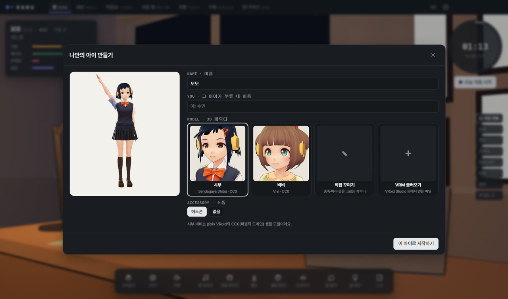

### 2. 평소의 방 — 그냥 켜 두고 관찰하기

방에 들어가면 그 아이가 인사해요. 화면 구성은 이래요.

- **왼쪽 위**: 이름·레벨·별(★)·작품 수와 기분·에너지·유대감·영감 막대
- **오른쪽 위 시계**: 오늘 작업까지 남은 시간. 「▶ 오늘 작품 시작」으로 바로 시작할 수도 있어요.
- **오른쪽 카메라 버튼**: 자동 연출 · 전체 · 책상 · 가까이 · 어깨 너머 · 이젤 · 창밖 · 책 읽는 곳. 화면을 끌면 돌려 보고, 휠로 확대해요.
- **아래 도구 막대**: 쓰다듬기 · 간식 · 커피 · 음 던지기 · 리듬 바꾸기 · 템포 · 물감 쏟기 · 속삭이기 · 말 걸기 · 불 켜기 · 노크

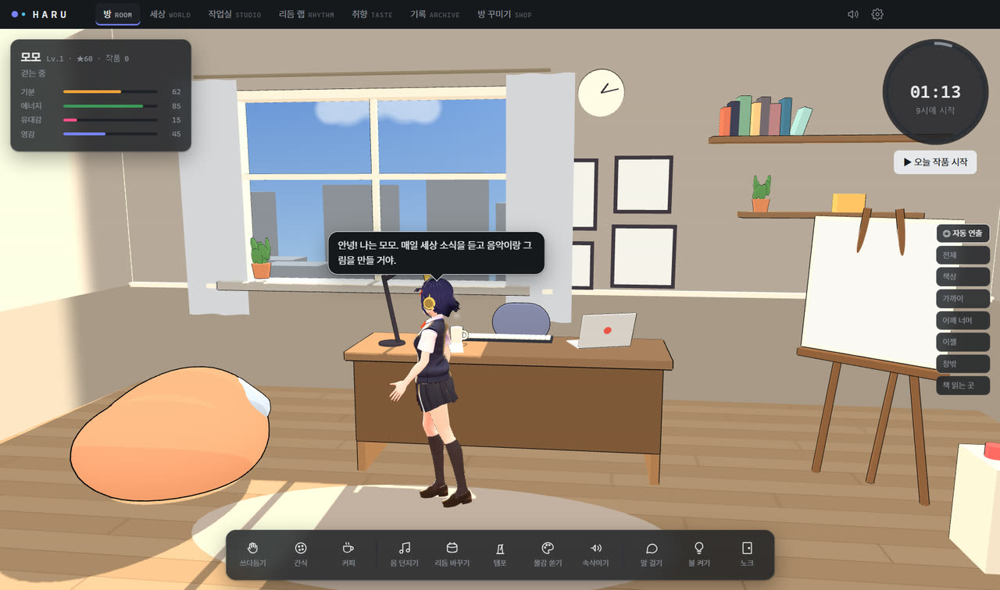

| 「가까이」 카메라 | 해 질 녘 (창밖이 실제 시간을 따라가요) | 밤 (도시 불빛, 스탠드 조명) |
|---|---|---|
| 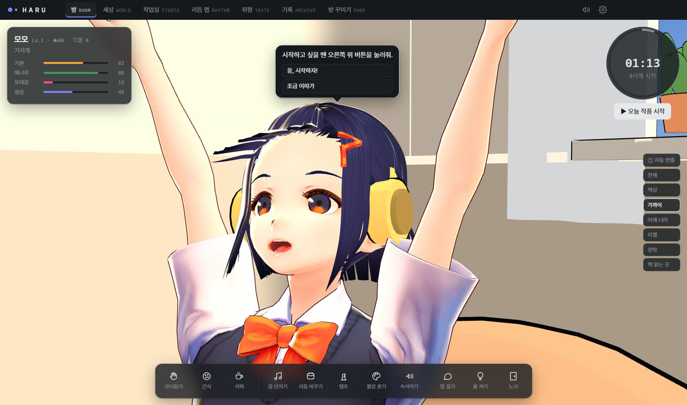 | 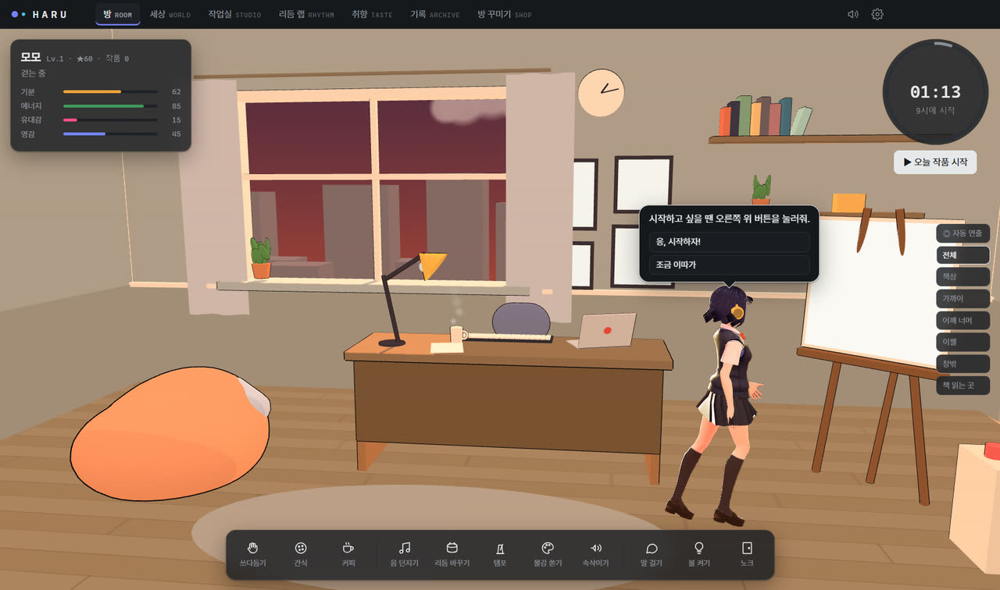 | 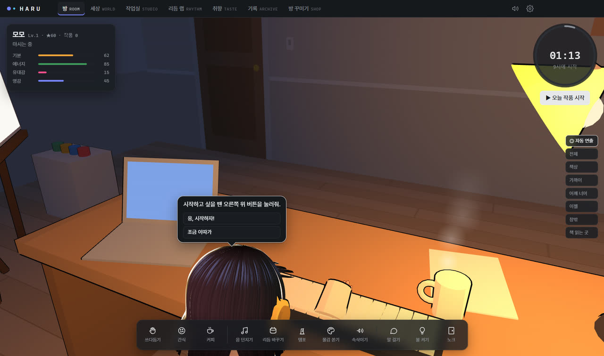 |

### 3. 하루 작업 — 세상 읽기 → 작곡 → 그림 → 완성

설정 › 일반의 자동 시작 시각이 되거나 「▶ 오늘 작품 시작」을 누르면 작업이 시작돼요. 왼쪽 위 패널에 **세상 · 생각 · 작곡 · 그림** 단계가 표시돼요.

**① 세상 읽기**: 빈백에 앉아 태블릿으로 뉴스·트렌드를 읽어요. 그동안 **세상(WORLD)** 탭에서 키워드 별자리, 세상의 기분, 수집처를 볼 수 있어요.

| 빈백에서 뉴스 읽는 중 | 세상 탭 (헤드라인 부분은 가렸어요) |
|---|---|
| 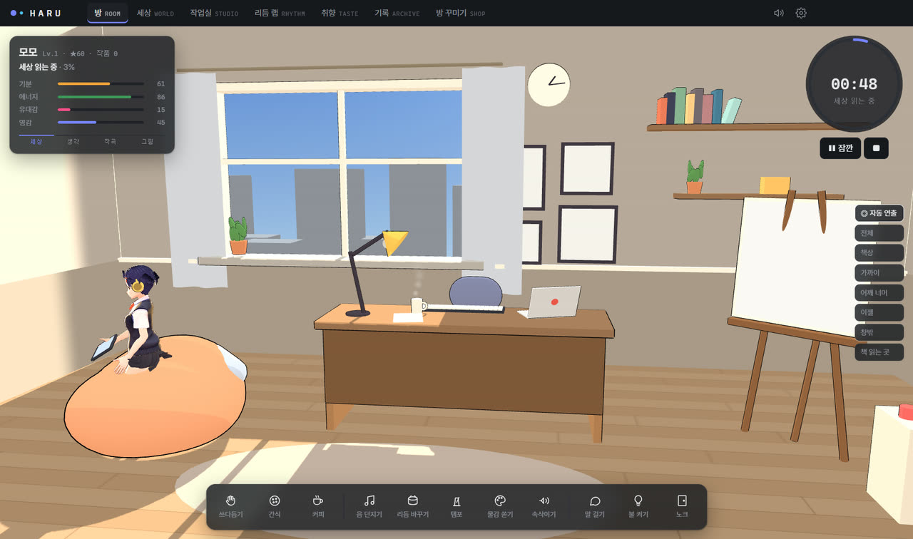 | 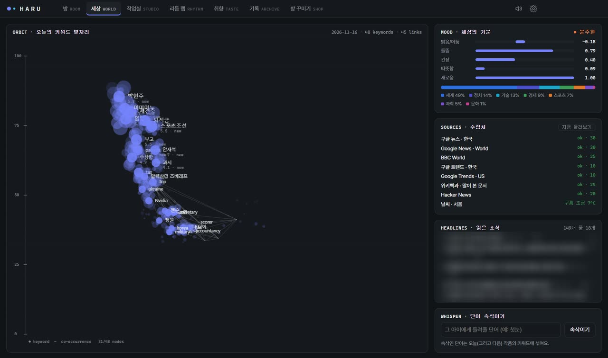 |

**② 작곡**: 책상에 앉아 오늘 고른 스타일과 장르를 말하고("좋아, 재즈 왈츠로 가볼게. B 도리안!") 실시간으로 연주하며 곡을 써요. **작업실(STUDIO)** 탭에서는 악보(피아노 롤)·파형·스펙트럼·곡 정보(장르·조성·스타일·악기·모티프)를 볼 수 있어요.


**③ 장난치기**: 작업 중에 끼어들 수 있어요. 작업실의 「음 던지기」 건반을 누르면 그 음이 곡에 들어가고(악보에 파란 막대), 그림 그릴 때 「물감 쏟기」를 하면 캔버스에 물감이 튀어요. 그 아이는 놀라지만, 결국 작품의 일부가 돼요.

| 던진 음이 악보에 들어간 모습 | 그림에 물감 쏟기 |
|---|---|
| 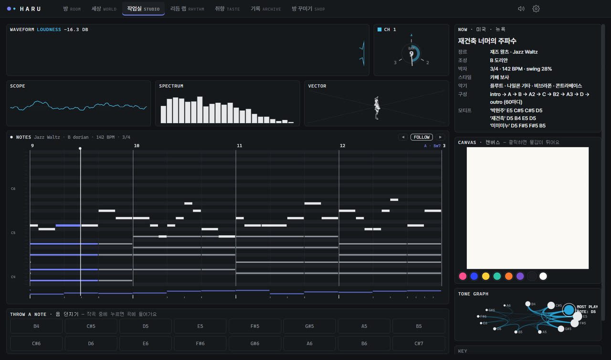 | 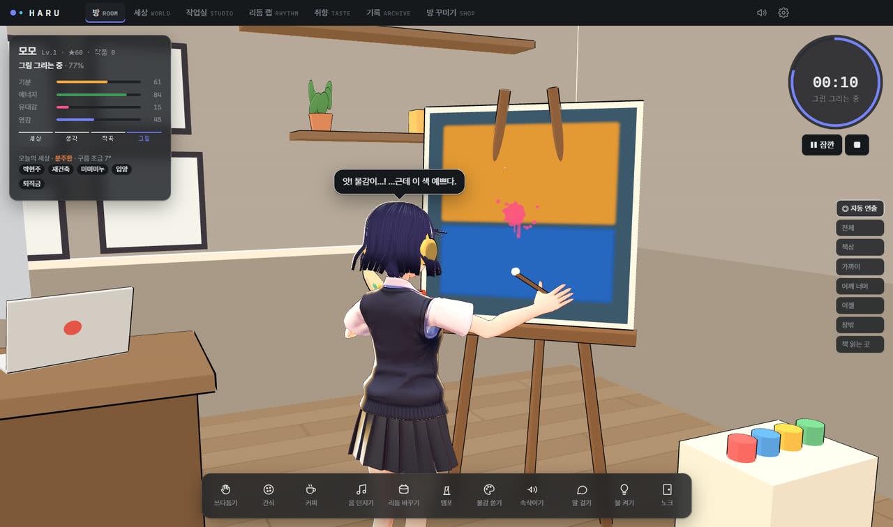 |

**④ 완성**: 곡을 녹음(MP3)하고, 포스터(PNG)·타임랩스(MP4)·일기를 저장한 뒤 완성 창을 띄워요. 별(★)과 작품 점수를 받아요.

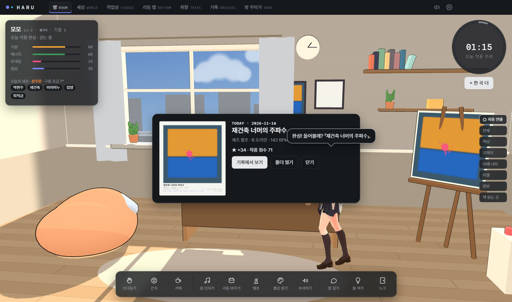

### 4. 지난 작품 보기 — 기록(ARCHIVE)

만든 작품이 쌓여요. 포스터, 타임랩스 영상, 음악 재생, 그 아이의 일기, 함께한 흔적(던진 음·쏟은 물감)을 볼 수 있어요. 「폴더 열기」로 저장 폴더(`문서\HARU\…`)를 열어요.

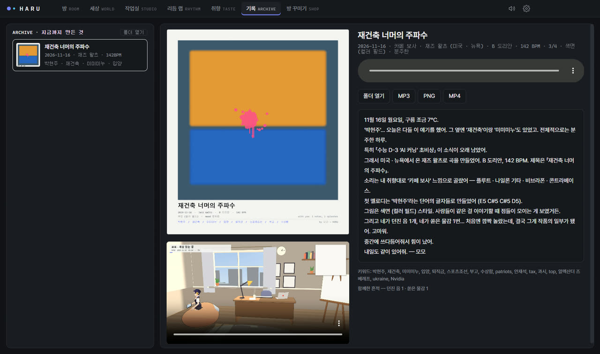

### 5. 음악 취향 — 취향(TASTE)

그 아이가 좋아하는 10가지 음악 스타일과 좋아하는 정도가 보여요. 「▶ 같이 듣기」로 8초 넘게 같이 들어주면 그 스타일을 더 좋아하게 되고, 「다음 곡에 추천」으로 부탁할 수도 있어요. 자세한 건 [음악 소리 · 취향](#음악-소리--취향)을 보세요.

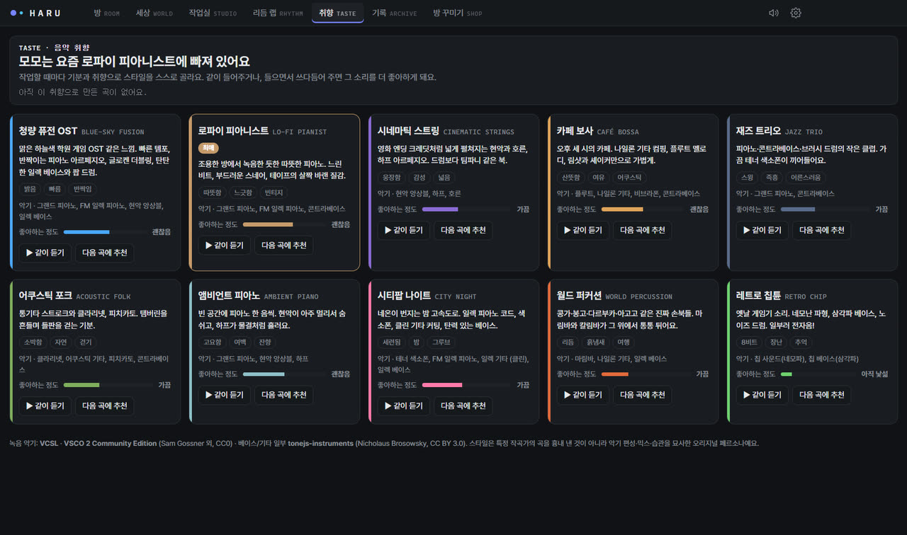

### 6. 리듬 가르치기 — 리듬 랩(RHYTHM)

세계 여러 장르의 리듬을 스텝 그리드로 직접 만져 보고, ▶ 재생으로 같이 들은 뒤 「들려주기 · 가르치기」를 누르면 그 아이가 장르를 배워요. 작업 중이면 「지금 곡에 이 리듬 넣기」로 장난을 칠 수도 있어요.

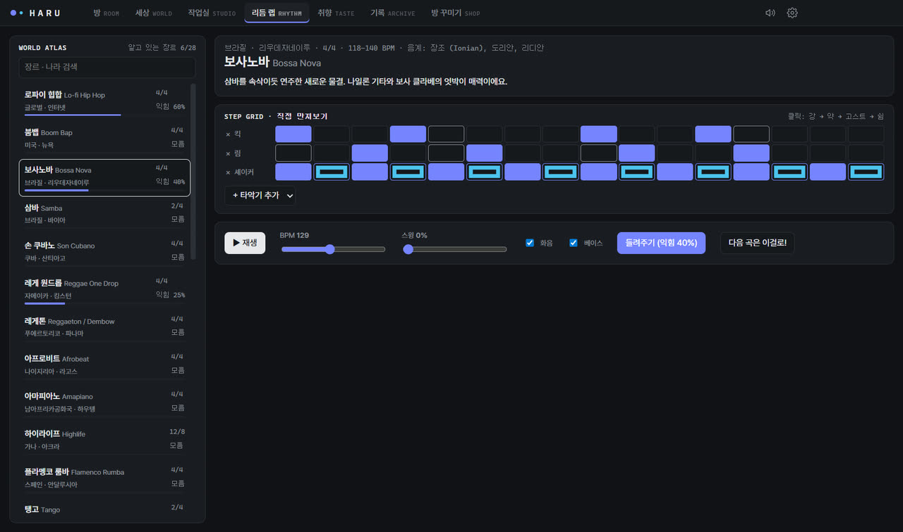

### 7. 방 꾸미기 · 캐릭터 바꾸기 · 설정

- **방 꾸미기(SHOP)**: 작품으로 모은 별(★)로 방 소품을 「들여요」.
- **캐릭터 꾸미기**: 오른쪽 위 ⚙ 설정 › 데이터 › 「캐릭터 다시 꾸미기」에서 언제든 모델·이름·소품을 바꿀 수 있어요.
- **설정**: 일반(자동 시작 시각·작업 시간·뽀모도로) · 창 · 미니 아바타 · 수집처 · 날씨 · 소리 · 창작 · 저장(곡 길이·음악 스타일·그림 스타일·녹화) · 화면 · AI 일기(선택) · 데이터.

| 방 꾸미기 | 캐릭터 꾸미기 | 설정 |
|---|---|---|
| 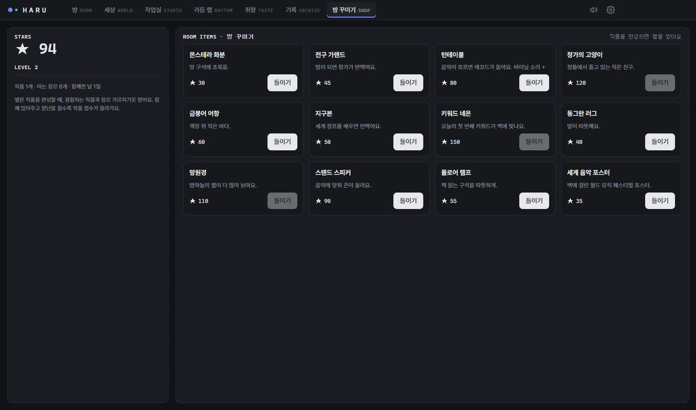 | 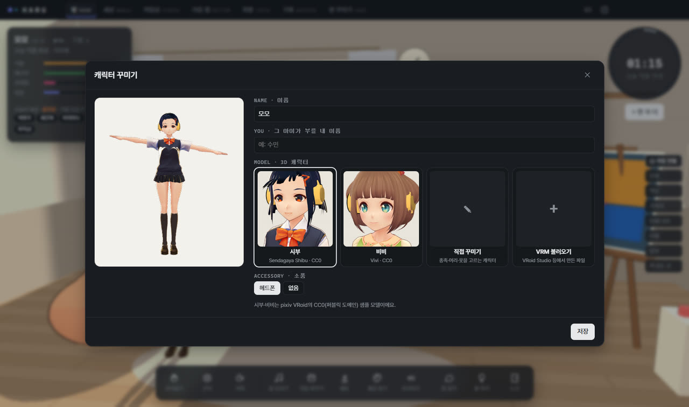 | 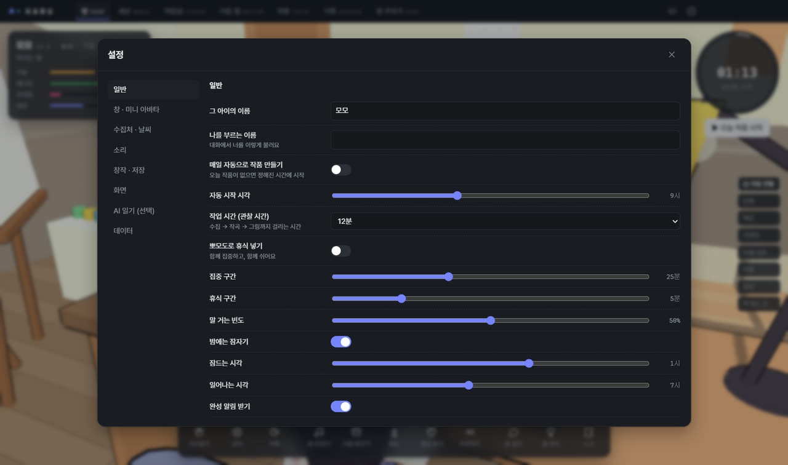 |

### 8. 창을 내렸을 때 — 바탕화면 미니 아바타 (Windows)

창의 「–」(최소화)를 누르면 그 아이가 작은 3D 아바타가 되어 바탕화면 위를 돌아다녀요(배경 투명). 말풍선으로 상태를 알려주고, 클릭하면 쓰다듬기, 더블클릭하면 원래 창으로 돌아와요. 움직이는 방식(떠다니기·걷기·구석·가만히)은 설정 › 창에서 바꿔요.


### 9. 휴대폰 · 태블릿

화면 위아래 시스템 바(상태 표시줄·내비게이션 바)를 피해서 그려요. 휴대폰에서는 메뉴 탭과 도구 막대를 옆으로 밀어서 넘겨요.

| 휴대폰 — 처음 실행 | 휴대폰 — 방 | 휴대폰 — 취향 |
|---|---|---|
| 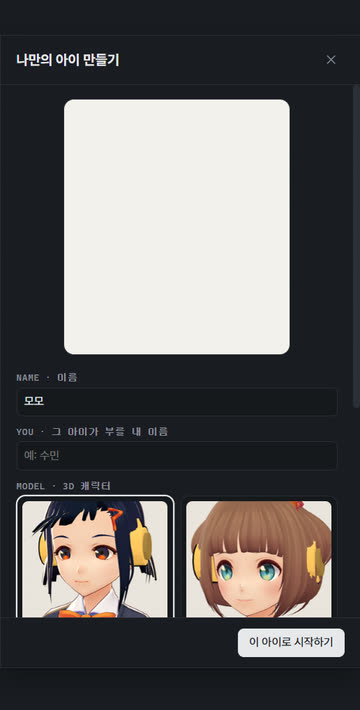 | 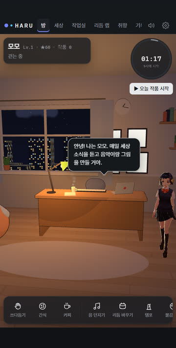 | 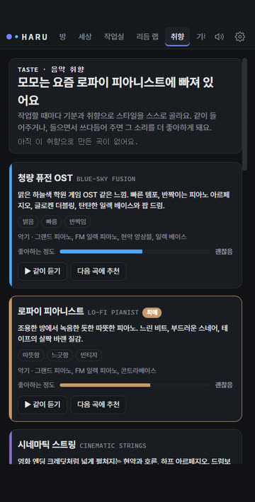 |

| 태블릿 (가로) — 방 | 태블릿 (가로) — 취향 |
|---|---|
| 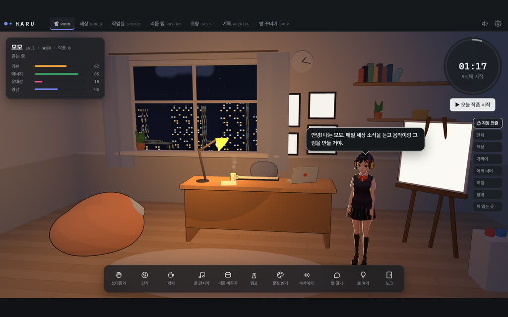 | 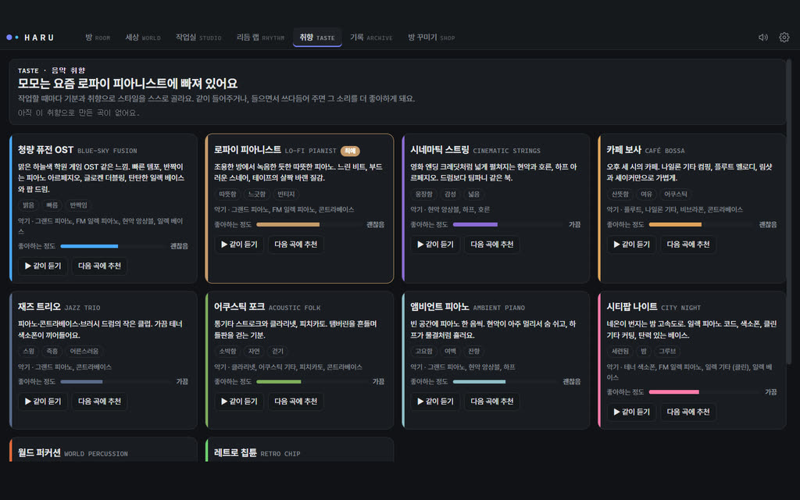 |

> 화면을 다시 찍으려면: Windows 화면은 `HARU_SHOT=<폴더> HARU_SHOT_PLAN=readme` 환경변수로 `electron . --fast`, 휴대폰·태블릿 화면은 `node tools/build-web.js` 후 `SA_OUT=<폴더> SA_SIZE=412x892 electron tools/shot-safearea.js` (태블릿은 `SA_SIZE=1280x800`).

## 3D 캐릭터 · 방

- 방은 three.js로 그린 3D 공간이에요. 창밖 하늘이 실제 시간을 따라 바뀌고(노을·밤하늘·도시 불빛), 해가 지는 시간엔 창문으로 노을빛이 들어와요.
- **관찰 시점**: 자동 연출 · 전체 · 책상 · 가까이(얼굴) · 어깨 너머 · 이젤 · 창밖 · 책 읽는 곳. 화면을 끌면 시점이 돌아가고, 휠·두 손가락으로 확대돼요.
- **기본 캐릭터는 아래 CC0(퍼블릭 도메인) 3D 모델**이에요. 캐릭터 꾸미기에서 바꿀 수 있어요.

| 모델 | 출처 | 라이선스 |
|---|---|---|
| 시부 (Sendagaya Shibu) — 기본 | pixiv VRoid Studio 샘플 모델, GitHub [madjin/vrm-samples](https://github.com/madjin/vrm-samples) `vroid/beta/` | CC0 1.0 (파일 안 VRM 메타데이터에도 `CC0`, 상업 이용 허용) |
| 비비 (Vivi) | 위와 같음 | CC0 1.0 |

  자세한 내용은 [src/assets/avatars/LICENSE.md](src/assets/avatars/LICENSE.md). 조건부 라이선스인 AvatarSample_A·B·C는 넣지 않았어요.
- **직접 꾸미기**: 종족·머리·옷·색을 고르는, 코드로 만든 3D 캐릭터.
- **내 VRM 불러오기**: [VRoid Studio](https://vroid.com/studio)(무료)에서 만든 `.vrm` 파일을 넣으면 그 아이가 대신 움직여요. 바탕화면 미니 아바타도 같은 모델이 돼요.
- 오래된 기기에서 버벅이면 설정 › 화면 › 방 그래픽을 **2D 가벼운 모드**로 바꿀 수 있어요. WebGL을 못 쓰는 기기는 자동으로 2D로 열려요.

## 음악 소리 · 취향

- 곡은 **실제로 녹음된 악기 소리**로 연주돼요 (그랜드 피아노, 현악 앙상블, 하프, 플루트, 색소폰, 비브라폰, 콘트라베이스, 기타, 콩가·봉고 같은 손북 등 19종 + 드럼 22종, 약 6MB).
  예전의 전자음 합성 대신 녹음 소리를 쓰고, 악기마다 좌우 자리·잔향을 따로 주고, 테이프 왜곡은 로파이 스타일에만 걸어서 소리가 부드럽고 깔끔해졌어요.
- **취향(TASTE) 탭**: 그 아이가 좋아하는 10가지 음악 스타일이 있어요.
  청량 퓨전 OST · 로파이 피아니스트 · 시네마틱 스트링 · 카페 보사 · 재즈 트리오 · 어쿠스틱 포크 · 앰비언트 피아노 · 시티팝 나이트 · 월드 퍼커션 · 레트로 칩튠
- 작업할 때마다 그 아이가 **자기 취향 × 오늘 기분 × 새로움**으로 스타일을 스스로 고르고, 왜 골랐는지 말해줘요. 그 다음에 어울리는 장르(리듬)를 골라요.
- 취향은 변해요: 잘 만든 곡의 스타일, 같이 8초 넘게 들어준 스타일(▶ 같이 듣기), 음악이 나올 때 쓰다듬어 준 스타일을 점점 더 좋아하게 돼요. 「다음 곡에 추천」으로 부탁할 수도 있어요.
- 설정 › 창작 › 음악 스타일에서 하나로 고정할 수도 있어요 (기본은 「그 아이 취향에 맡기기」).
- 스타일은 특정 작곡가의 곡을 베낀 게 아니라 악기 편성·믹스·습관을 묘사한 오리지널 설정이에요.
  (블루 아카이브 같은 게임 OST 작곡가 중에 곡을 CC0로 푼 사람은 찾지 못했어요. 그래서 CC0 녹음 악기 + 오리지널 스타일 조합으로 만들었어요.)
- 녹음 출처는 [src/assets/samples/CREDITS.md](src/assets/samples/CREDITS.md). 샘플을 다시 만들려면 `node tools/build-samples.js` (ffmpeg 필요).

## 하루의 흐름

1. **세상 읽기**: 구글 뉴스(한국/세계), BBC, 구글 트렌드(한국/미국), 위키백과 많이 본 문서, Hacker News, 날씨(Open-Meteo) 수집
2. **생각 정리**: 키워드 추출, 동시출현 네트워크, 기분(밝음·들뜸·긴장·따뜻함·새로움), 분야 분포
3. **작곡**: 취향·기분으로 음악 스타일 선택 → 기분 + 나라 언급 + 알고 있는 장르 + 스타일 궁합으로 장르 선택 → 키워드 글자로 모티프 → 코드 → 베이스 → 드럼 → 멜로디 순으로 써 내려감 (실시간 연주)
4. **그림**: 6가지 화풍(궤도·흐름·색면·수묵·바우하우스·점묘) 중 하나로 한 획씩
5. **마무리**: 오프라인 렌더 → MP3, 포스터 PNG, 타임랩스 MP4, 일기 저장 → 별(★) 보상

결과물: `문서\HARU\날짜_시각_제목\` (music.mp3 · art.png · art_square.png · process.mp4 · diary.md · meta.json)

## 같이 놀기 (장난)

방 아래 도구 막대 — 쓰다듬기 · 간식 · 커피 · **음 던지기**(곡에 바로 들어감) · **리듬 바꾸기**(드럼이 다른 나라 리듬으로) · 템포 · **물감 쏟기**(이젤 클릭) · **단어 속삭이기**(키워드에 섞임) · 말 걸기 · 불 · 노크.
그 아이의 유대감·기분·집중도에 따라 반응이 달라지고, 한 일은 전부 작품과 일기에 남아요.

## 리듬 랩

27개 세계 장르(보사노바, 손 쿠바노, 아프로비트, 아마피아노, 발칸 7/8, 라가, 가믈란, 굿거리장단, 켈틱 지그…)의 스텝 그리드를 직접 만지고, BPM·스윙을 바꿔 들어볼 수 있어요.
- **들려주기**: 6초 이상 같이 들은 뒤 누르면 그 아이가 장르를 배움 → 이후 작품에 등장
- **다음 곡은 이걸로!**: 다음 작품 장르 요청
- **지금 곡에 이 리듬 넣기**: 작곡 중인 곡의 드럼을 내가 만든 패턴으로 교체

## 창 · 미니 아바타

- `–`(최소화) → 바탕화면에 작은 아이가 떠다님 (떠다니기 / 작업표시줄 위 걷기 / 구석 / 가만히)
- 미니 아바타: 클릭 = 쓰다듬기, 더블클릭 = 메인 창 열기, 드래그 = 옮기기, 우클릭 = 메뉴
- `X` → 트레이로 숨김(작업 계속). 설정에서 "완전히 종료"로 변경 가능
- 윈도우 시작 시 자동 실행 / 미니 아바타로 시작 옵션

## 설정

일반(이름, 매일 자동 시작 시각, 작업 시간 3분~2시간, 뽀모도로 휴식, 밤에 잠자기), 창·미니 아바타, 수집처(RSS 추가, 도시 검색), 소리(음량, 로파이 질감, 목소리, 9종 환경음, 날씨 연동), 창작(곡 길이, 화풍, 해상도, 영상), 화면(테마, 자동 연출 카메라, UI 크기), **AI 일기(선택)**: Anthropic API 키를 넣으면 Claude가 일기를 그 아이 말투로 써줌(기본 모델 `claude-opus-5-5`, 키는 Windows 자격 증명으로 암호화 저장).

## 개발

```powershell
npm install
npm start            # 실행
npm run fast         # 작업 시간 50초 테스트 모드
npm run icon         # build/icon.png 다시 그리기
npm run dist         # 설치 파일 빌드 → dist/
npm run android      # 안드로이드 APK → android/app/build/outputs/apk/debug/
```
안드로이드 빌드는 `%LOCALAPPDATA%\haru-build\jdk-21*` (포터블 JDK 21)과 `%LOCALAPPDATA%\Android\Sdk` 를 사용해요. Gradle 버전은 8.14.3으로 고정해야 해요(9.6+는 현재 Android Gradle Plugin과 호환 안 됨).
3D 엔진(three.js + three-vrm)은 `tools/build-3d.js` 가 esbuild로 `src/js/vendor/three-bundle.js` 한 파일로 묶어요 (`npm start`·`dist`·`android` 가 자동 실행). 3D 코드: `src/js/char3d.js`(캐릭터·VRM 포즈), `src/js/room3d.js`(방·조명·카메라). 개발용 미리보기: `tools/shot-3d.js`, `tools/shot-vrm.js`.
모바일 코드는 `src/` 를 그대로 쓰고, `tools/build-web.js` 가 `www/` 를 만들면서 `src/js/platform-mobile.js` (Capacitor 연결층)를 끼워 넣어요.
VS Code 터미널에서는 `ELECTRON_RUN_AS_NODE`가 설정돼 있을 수 있으니 먼저 `Remove-Item Env:ELECTRON_RUN_AS_NODE`.
`tools/test-main.js`: 작곡·렌더·MP3·MP4 성능 측정용 하네스.
서비스 소개서 PDF는 `docs/brochure/brochure.html` 을 고친 뒤 `npx electron tools/make-brochure.js` 로 다시 만들어요 (→ `docs/HARU-service-overview.pdf`).

## 차용한 외부 자원의 라이선스

우리 라이선스: Apache-2.0 (LICENSE 파일)

- 확인 날짜: 2026-11-11 (아래 주소는 모두 이 날짜에 열람하거나 조회했습니다)
- 범위: 앱 코드(`src/`)·의존성(`package.json`)·번들 에셋에서 실제로 쓰는 외부 자원만 적었습니다. 연구 문서에 조사만 되고 앱에 들어 있지 않은 모델·데이터셋(MusicGen, text2midi, Stable Audio Open, AudioLDM 2, MidiCaps, EMOPIA, MusicCaps 등)은 저장소 검색 결과 0건이라 제외했습니다.

### 번들 에셋 (배포물에 포함)

| 이름 | 종류 | 출처 주소 | 라이선스 | 확인 내용 | 비고 |
|---|---|---|---|---|---|
| Sendagaya Shibu (`shibu.vrm`), Vivi (`vivi.vrm`) | 3D 캐릭터 모델 | https://github.com/madjin/vrm-samples (README의 CC0 models 절), https://creativecommons.org/publicdomain/zero/1.0/ | CC0 1.0 | 두 파일의 VRM 메타데이터 `licenseName: CC0`, `commercialUssageName: Allow`를 직접 읽음 | 미확인: LICENSE.md가 적은 `vroid/beta/` 경로는 열지 않음. AvatarSample_A·B·C는 포함하지 않음 |

| VCSL (일부 샘플, `src/assets/samples/`) | 녹음 악기·드럼 샘플 | https://github.com/sgossner/VCSL | CC0 1.0 | 저장소 README/LICENSE의 CC0 표기 확인 | 잘라내고 정규화해 MP3로 변환 |
| VSCO 2 Community Edition (일부 샘플) | 오케스트라 악기 샘플 | https://github.com/sgossner/VSCO-2-CE | CC0 1.0 | 저장소 README/LICENSE의 CC0 표기 확인 | 잘라내고 정규화해 MP3로 변환 |
| tonejs-instruments (일부 샘플) | 베이스·기타 샘플 | https://github.com/nbrosowsky/tonejs-instruments | 샘플 CC BY 3.0 | 저작자 표시 필요 → CREDITS.md·앱 취향 탭에 표기 | 잘라내고 정규화해 MP3로 변환 |

### 런타임 의존성 (배포물에 포함)

| 이름 | 용도 | 출처 주소 | 라이선스 | 비고 |
|---|---|---|---|---|
| lamejs 1.2.1 | MP3 인코딩 (`src/js/recorder.js`, `src/index.html`, 빌드 시 `tools/build-web.js`가 복사) | https://registry.npmjs.org/lamejs/1.2.1 | LGPL-3.0 | 배포 시 LGPL 고지 조건 확인 필요 (법적 판단 보류) |
| mp4-muxer 5.2.2 | MP4 타임랩스 (`recorder.js`) | https://registry.npmjs.org/mp4-muxer/5.2.2 | MIT | npm 표기: 이 패키지는 Mediabunny로 대체 권고 |
| three 0.187.0 | 3D 방·캐릭터 (`vendor/three-bundle.js`) | https://registry.npmjs.org/three/0.187.0 | MIT | |
| @pixiv/three-vrm 3.5.5 | VRM 로더 | https://registry.npmjs.org/@pixiv/three-vrm/3.5.5 | MIT | |
| @anthropic-ai/sdk 1.6.0 | AI 일기 (API 키를 넣은 경우만) | https://registry.npmjs.org/@anthropic-ai/sdk/1.6.0 | Apache-2.0 | |
| @capacitor/core, android, ios 8.6.0 | 모바일 연결층 | https://registry.npmjs.org/@capacitor/core/8.6.0 (android·ios 동일 형식) | MIT | |
| @capacitor/app 8.1.2, filesystem 8.1.5, local-notifications 8.3.1, preferences 8.0.1, share 8.0.3 | Capacitor 플러그인 | https://registry.npmjs.org/@capacitor/[이름]/[버전] | MIT | |

### 빌드 도구

| 이름 | 출처 주소 | 라이선스 | 비고 |
|---|---|---|---|
| electron 38.4.0 | https://registry.npmjs.org/electron/38.4.0 | MIT | Windows 설치 파일에 Electron 본체와 Chromium 등 하위 자원이 들어가므로 배포물에 포함됨. 하위 고지 파일 원문은 미확인 |
| electron-builder 26.0.12 | https://registry.npmjs.org/electron-builder/26.0.12 | MIT | |
| esbuild 0.28.2 | https://registry.npmjs.org/esbuild/0.28.2 | MIT | |
| @capacitor/cli 8.6.0 | https://registry.npmjs.org/@capacitor/cli/8.6.0 | MIT | devDependencies(`^8.6.0`). package-lock 의 `"dev": true` 로 개발 전용 확인. 앱 코드(`src/`)·저장소 전체 검색에서 참조 없음(package.json·lock 외 0건) |

### 런타임 데이터 출처 (외부 API·피드)

| 출처 | 주소 | 이용 조건 | 상태 |
|---|---|---|---|
| Google 뉴스 RSS | https://news.google.com/rss | 약관 미열람 | 미확인 |
| Google 트렌드 RSS | https://trends.google.com/trending/rss | 약관 미열람 | 미확인 |
| BBC World RSS | https://feeds.bbci.co.uk/news/world/rss.xml | https://www.bbc.co.uk/usingthebbc/terms-of-use/ (2022-09-19 갱신본). 개인이 RSS 메타데이터를 가져가는 것을 금지하고, 업무 이용은 사전 허락과 비용이 필요할 수 있음 | 원문 확인. 공개 배포 시 제한 검토 필요 |
| Wikimedia 추천 문서 API | https://api.wikimedia.org/feed/v1/wikipedia/ | 문서 텍스트는 CC BY-SA 4.0 (https://en.wikipedia.org/wiki/Wikipedia:Reusing_Wikipedia_content). API 데이터 자체의 조건은 미열람. 앱은 문서 제목만 사용 (`world.js`) | 부분 확인 |
| Open-Meteo 날씨·지오코딩 | https://api.open-meteo.com, https://geocoding-api.open-meteo.com | https://open-meteo.com/en/terms: 무료 API는 비상업 전용, 데이터는 CC-BY 4.0, 일 1만 호출 제한. 구독·광고가 붙으면 상업 이용으로 봄 | 원문 확인. 상업 전환 시 유료 플랜 필요 |
| Hacker News 프론트페이지 (hnrss) | https://hnrss.org/frontpage | hnrss.org 조건 미열람. HN API 저장소(https://github.com/HackerNews/API)는 사이드바에 MIT 표기 (LICENSE 원문 미열람) | 미확인 |

### 미확인 · 다음 할 일

- Google 뉴스·트렌드 RSS 약관 열람
- BBC RSS와 Open-Meteo의 상업 이용 판단 (대표님 결정)
- lamejs의 LGPL 고지 방식, Electron 설치물의 하위 고지 파일 원문
- `vroid/beta/` 경로의 원문 확인
- Wikimedia API 데이터 조건, hnrss.org 조건

이 절은 확인한 내용을 옮긴 기록입니다. 법적 판단은 하지 않았습니다.
